# momias_guanajuato

A new Flutter project.

## Getting Started

This project is a starting point for a Flutter application.

A few resources to get you started if this is your first Flutter project:

- [Learn Flutter](https://docs.flutter.dev/get-started/learn-flutter)
- [Write your first Flutter app](https://docs.flutter.dev/get-started/codelab)
- [Flutter learning resources](https://docs.flutter.dev/reference/learning-resources)

For help getting started with Flutter development, view the
[online documentation](https://docs.flutter.dev/), which offers tutorials,
samples, guidance on mobile development, and a full API reference.

## Guía de Evidencias (Capturas de Pantalla Obligatorias por Ronda)

Para cada una de las rondas del desarrollo guiado por TDD, toma **dos capturas de pantalla** de la terminal ejecutando `flutter test`:

1. **ROJO:** La prueba escrita que falla (falla roja en la terminal).
2. **VERDE:** La prueba pasando de manera exitosa tras implementar el código mínimo (éxito verde en la terminal).

Las capturas que ya están en `assets/` se muestran a continuación. Las evidencias marcadas como **Pendiente** no se encontraron entre los archivos disponibles; agrega la captura correspondiente cuando la tengas.

### RONDA 1 — Colisión entre rectángulos (AABB)

- **1A — ROJO:** 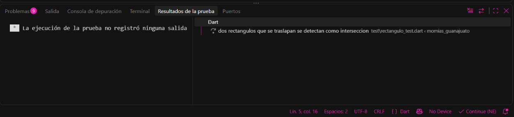
- **1B — VERDE:** 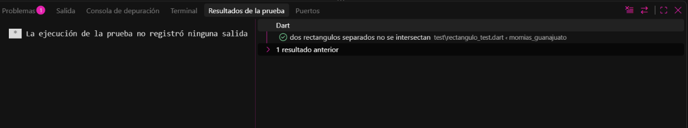

### RONDA 2 — Gravedad y salto

- **2A — ROJO:** **Pendiente de agregar** (captura del fallo de `motor_fisica_test.dart`).
- **2B — VERDE:** 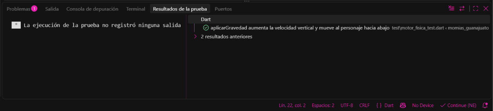
- **2B — VERDE:** 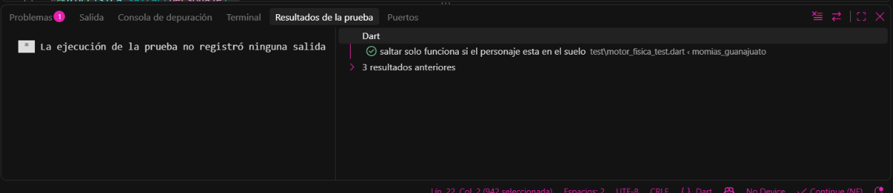
- **2B — VERDE:** 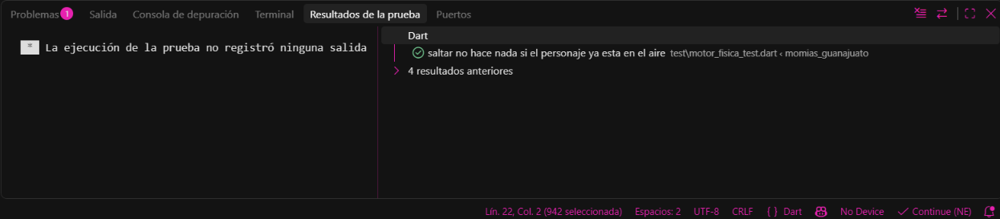

### RONDA 3 — Aterrizar sobre una plataforma

- **3A — ROJO:** 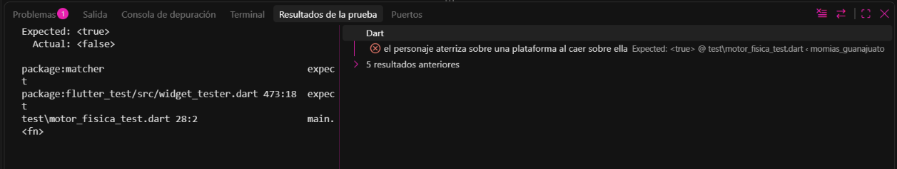
- **3B — VERDE:** 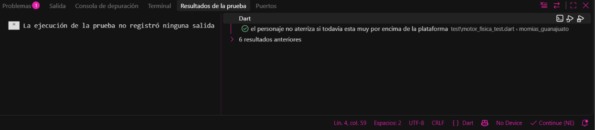

### RONDA 4 — Movimiento horizontal con límites del nivel

- **4A — ROJO:** **Pendiente de agregar** (captura de las pruebas de `moverHorizontal` fallando).
- **4B — VERDE:** 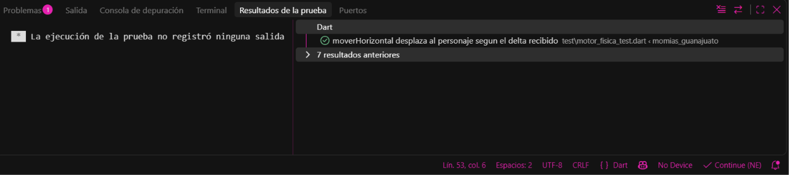
- **4B — VERDE:** 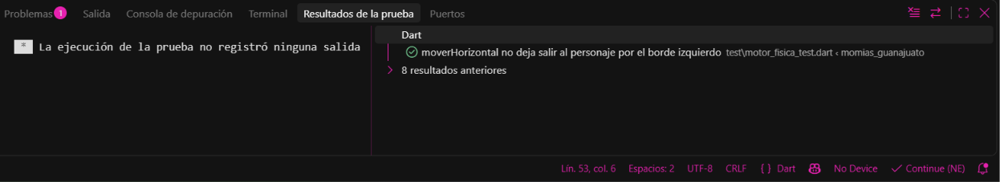
- **4B — VERDE:** 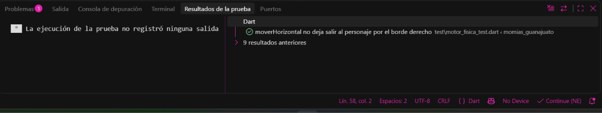

### RONDA 5 — La momia patrulla entre dos límites

- **5A — ROJO:** **Pendiente de agregar** (captura de `momia_test.dart` fallando).
- **5B — VERDE:** 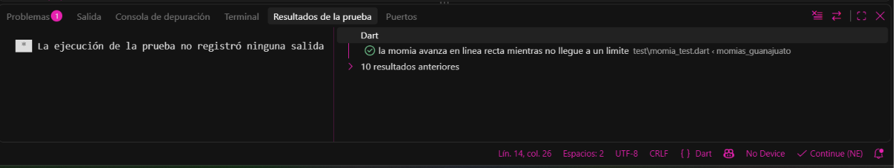
- **5B — VERDE:** 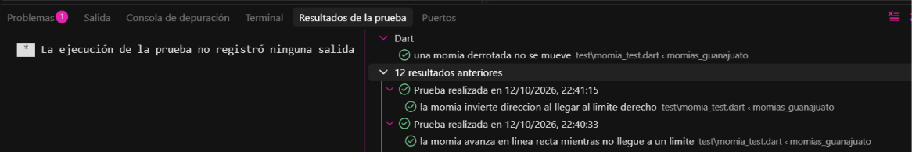

### RONDA 6 — Combate: saltar encima derrota, chocar de lado golpea

- **6A — ROJO:** 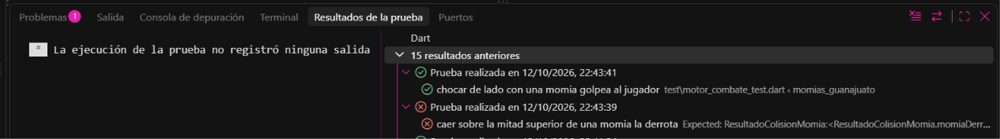
- **6B — VERDE:** La misma captura muestra también el resultado exitoso de la colisión lateral; **pendiente de agregar** una captura verde completa de `motor_combate_test.dart`.

### RONDA 7 — Recolectar calaveritas

- **7A — ROJO:** **Pendiente de agregar** (captura del test de recolección fallando).
- **7B — VERDE:** 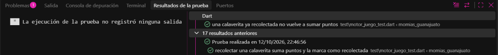

### RONDA 8 — Detectar la meta (el Callejón del Beso)

- **8A — ROJO:** **Pendiente de agregar** (captura del test de meta fallando).
- **8B — VERDE:** 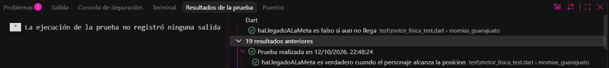

### RONDA 9 & 10 — Vidas, Game Over y MotorJuego Integrado

- **9A — ROJO:** **Pendiente de agregar** (captura de las pruebas de pérdida de vidas y Game Over fallando).
- **9B — VERDE:** **Pendiente de agregar** una captura de terminal con la ejecución completa de `flutter test` y todas las pruebas pasando.

### RONDA 11 — Ejecución del juego en interfaz gráfica (Flutter Run)

- **Captura del juego en ejecución:** 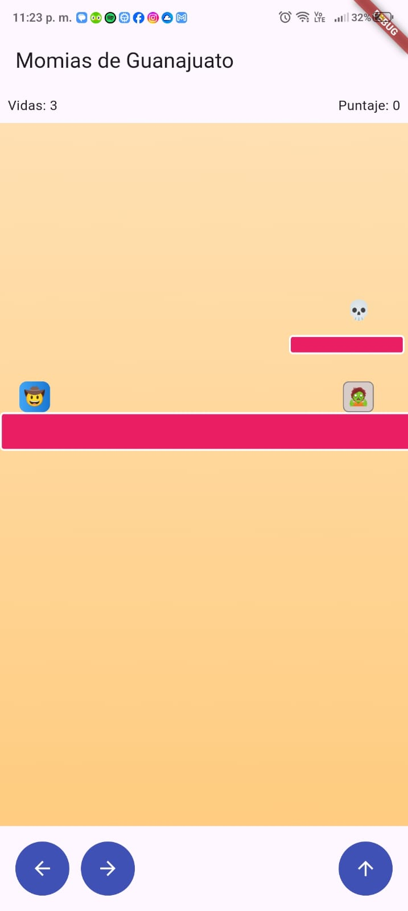
- **Captura durante una partida:** 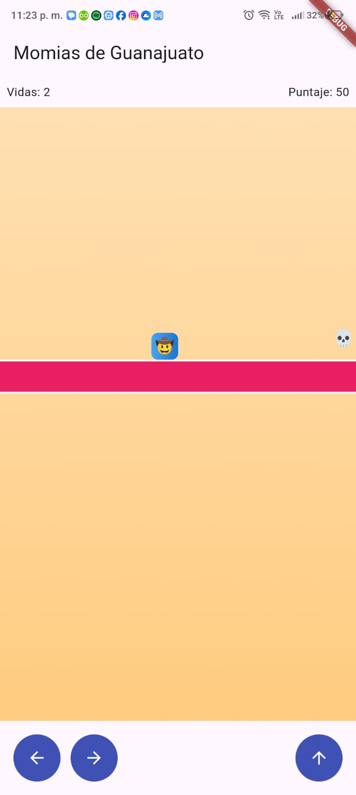
- **Captura al llegar a la meta:** 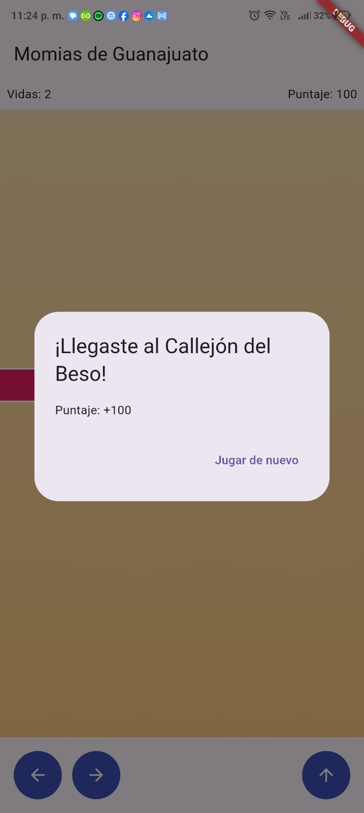
